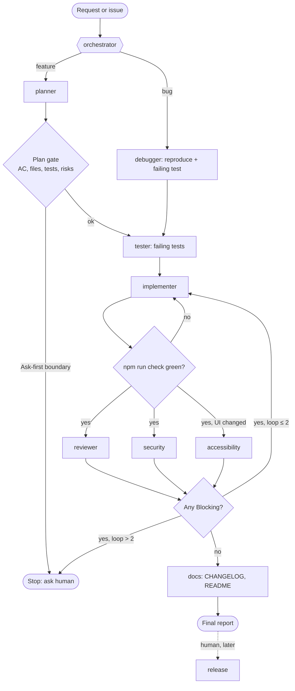

# Agent workflow

How the orchestrator moves a request through the specialist agents, and where each gate sits.

## Why tests come before implementation

The tester writes failing tests from the planner's acceptance criteria *before* the implementer starts.
That gives the implementer an unambiguous target, and means the reviewer can check the tests would fail
if the change were reverted. It also stops the implementer from writing tests that merely describe
whatever it happened to build.

## Why reviewers cannot edit

`reviewer`, `security` and `accessibility` have no `edit` tool. An agent that can fix what it reviews
tends to quietly patch symptoms instead of reporting them, and the orchestrator loses the signal. Findings
go back to `implementer` verbatim.

## The delegation brief

Subagents start with a fresh context, so the orchestrator passes a structured brief
(GOAL, CONTEXT, SCOPE, ACCEPTANCE, RETURN). See `.github/agents/orchestrator.agent.md`.

## Running it without subagents

On surfaces without subagent support, or if you prefer control, drive the same flow manually with the
VS Code handoff buttons: **planner → tester → implementer → reviewer → implementer (fixes)**.
The agent bodies are written to work either way.

## Guardrails outside the model

| Layer | Mechanism | Where |
| --- | --- | --- |
| Instructions | Non-negotiables and boundaries | `copilot-instructions.md`, `AGENTS.md` |
| Tool scoping | Least-privilege `tools:` per agent | `.github/agents/*.agent.md` |
| Hooks | Deny pushes, publishes, installs, destructive commands | `.github/hooks/` |
| CI | Tests, sink lint, a11y check, config validation | `.github/workflows/ci.yml` |
| Humans | CODEOWNERS on agent config and workflows | `.github/CODEOWNERS` |
